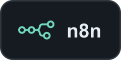
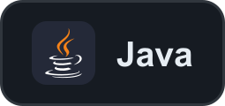
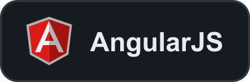
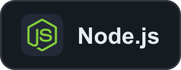
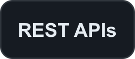
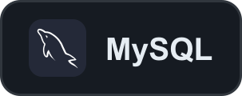
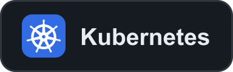

<table align="center">
<tr><td align="center">

    

</td></tr>
</table>

# 👋🏻 Hey there! I'm Chaitanya Malani

  

I'm a software engineer with 2+ years of experience across India and France, spanning full-stack development, automation, DevOps, data pipelines, and AI-powered applications.

I hold a Master's in Computer Science from EPITA, Paris. I enjoy building useful software, automating complex workflows, and connecting applications with data and AI—from web platforms and cloud deployments to RAG and agentic workflows.

## 🧰 My Tech Toolbox 🛠️

### AI & workflow automation

      

### Languages

   

### Web & backend

      

### Databases

   

### Cloud & infrastructure

     

### Data platforms

 

### Version control & delivery

   
